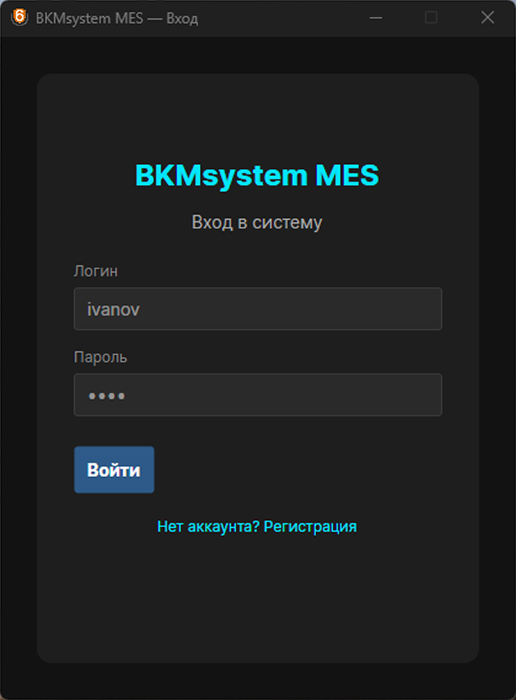
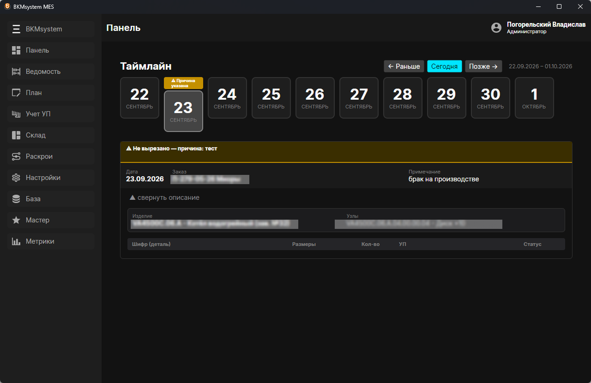
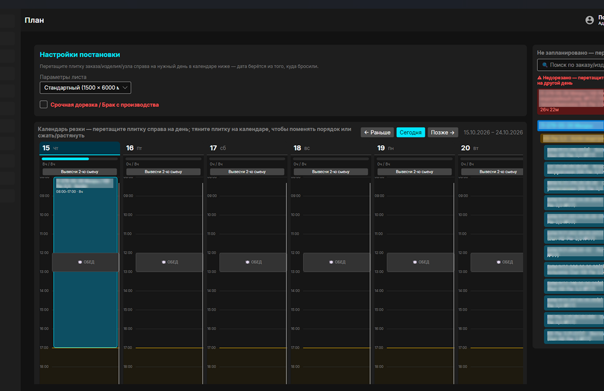
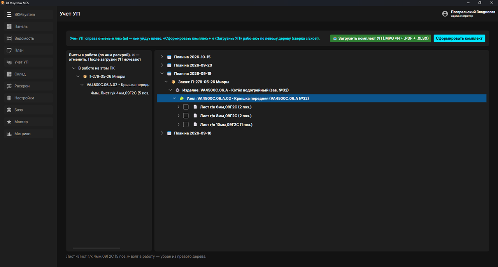
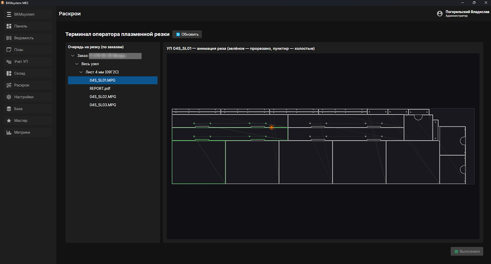
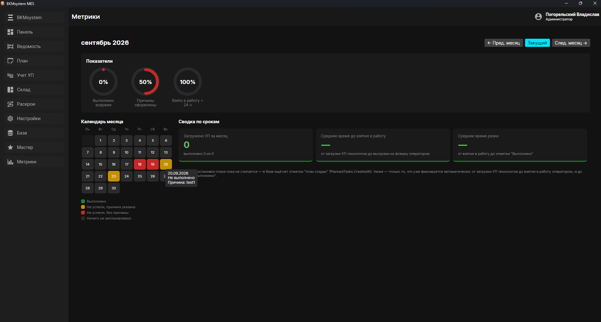
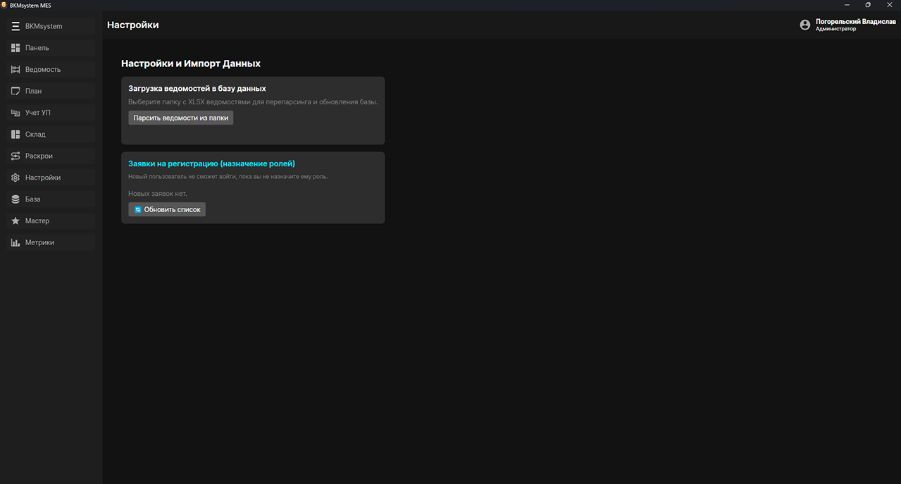

# BKMsystem

Настольное MES-приложение для участка плазменной резки: планирование по сменам, терминал оператора, разбор отчётов раскроя AJAN, аналитика сроков для руководства.

Личный pet-проект. Написан с нуля одним человеком по задачам реального производства (машиностроительный завод), на примере которого проектировалась предметная область.

>  
> 
>  
> 
> 
> 
> 


## Возможности

- **Планирование (ПДО)** — календарь заданий по заказам, изделиям и узлам; смены, обед, вторая смена на выбранные даты; расчёт загрузки по нормам времени резки.
- **Терминал оператора** — очередь раскроев по заказам, просмотр PDF-отчёта, анимация реза по G-коду (УП), выгрузка УП на флешку, отметка «Выполнено».
- **Импорт раскроев AJAN** — автоматический разбор PDF и Excel: листы, детали, время резки, привязка карт к заказам и узлам.
- **Кабинет технолога** — загрузка комплектов, учёт УП по датам и заказам, архив с возвратом карты в работу.
- **Мастер и директор** — статус выполнения по дням, причины невыполнения, кольцевые показатели, тепловая карта месяца, сравнение нормы из ведомости с фактическим временем резки по узлам.
- **Роли и доступ** — регистрация с подтверждением администратором, права по ролям.
- **Многопользовательская работа** — изменения приходят всем мгновенно через PostgreSQL `LISTEN/NOTIFY`; при потере связи с сервером работает офлайн-очередь с последующей синхронизацией.

## Стек

C#, .NET, Avalonia UI (MVVM, CommunityToolkit.Mvvm), PostgreSQL (Npgsql), разбор PDF и Excel, самописная визуализация (кольцевые индикаторы, календарная карта).

## Запуск

Требования: .NET SDK (версия указана в `.csproj`) и PostgreSQL.

1. Создайте базу данных, например `bkm_db`.
2. Скопируйте `appsettings.example.json` в `appsettings.local.json` и впишите свою строку подключения  
   (либо задайте переменную окружения `BKM_DB_CONNECTION`).
3. Запустите:
   ```
   dotnet run
   ```
4. Таблицы создаются автоматически при первом запуске. Первый зарегистрированный пользователь становится администратором и подтверждает остальных.

## Структура

- `Views/` — окна и вкладки (Avalonia XAML)
- `ViewModels/` — логика представлений (MVVM)
- `Services/` — работа с БД, планирование, импорт раскроев, парсеры PDF/Excel, офлайн-синхронизация
- `Models/` — модели данных

## Статус

Рабочий прототип, использовавшийся в реальных условиях. Нормы скорости и врезки резки (`CncCuttingNorms`) заполняются из встроенного набора данных и подлежат проверке под ваше оборудование.
